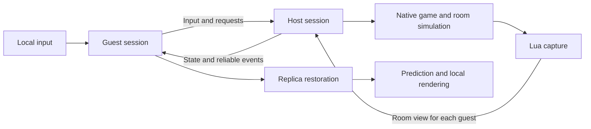

# Architecture Overview

Isaac LAN loads a native DLL into the game process and embeds a Lua bridge. The host runs the original gameplay and simulates separate rooms. Guests submit input, apply authoritative state, and render their own room. Game objects, Lua calls, state capture/application, and session decisions stay on the game's main thread. A network thread handles event-driven sending, receiving, and real-time byte processing. An on-demand bulk-data worker handles save compression, validation, and decompression. Threads transfer ownership of independent data; they do not share game objects.

## Technical Choices

| Choice | Benefit | Cost or constraint |
| --- | --- | --- |
| Host-authoritative state synchronization | Processes do not need to keep all RNG state and execution order identical. | State must be captured, encoded, and applied. Damage, pickups, and similar actions wait for the host's result. |
| Native backend + Lua bridge | Reuses original rooms, combat, saves, and multiplayer HUD. | Native calls, memory layouts, and object lifetimes must be checked for each game version. |
| IPv4/IPv6 UDP/ENet | Real-time views may become stale, while control transactions and checkpoints are delivered reliably. | Missing fragments discard an entire real-time view. Reliable recovery shares bandwidth, so backlogs still need limits. |
| Local movement prediction | Movement does not need to wait for every network acknowledgement. | Used for display only; complex forces and special movement may require correction. |

The loading chain is `winmm.dll → isaac_lan_probe.dll → embedded Lua`. Separate-room simulation is implemented by switching native room contexts in sequence. Each guest view contains the main state of all party characters, the shared map, and the entities, grids, and presentation data for that guest's local room.

## Support Boundaries

- The native backend targets Windows x86 Repentance+ `v1.9.7.17.J460`. Newer versions require revalidation of entry points, ABI, and memory layouts.
- All players must use the same protocol and extension build. Mod differences are reported, but private mod data is not synchronized generically.
- The host cannot be migrated. Resuming a full run requires the original player count and join order. A guest reconnecting during a run is restored using its retained player identity.

Depending on the task, read [Layers and Ownership](https://github.com/BMingSY/isaac-lan/blob/main/docs/layers-and-compatibility.md), [Synchronization Contract](https://github.com/BMingSY/isaac-lan/blob/main/docs/synchronization.md), [Session Recovery](https://github.com/BMingSY/isaac-lan/blob/main/docs/session-lifecycle.md), or [Rooms and Presentation](https://github.com/BMingSY/isaac-lan/blob/main/docs/rooms-and-presentation.md). Build and verification entry points are documented in [Development and Testing](https://github.com/BMingSY/isaac-lan/blob/main/docs/development-and-testing.md).
