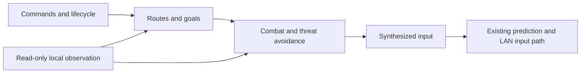

# LANBOT Implementation and Constraints

LANBOT reads existing views and synthesizes normal movement and shooting input. The host remains authoritative for damage, pickups, teleportation, and item effects. See the [user guide](https://github.com/BMingSY/isaac-lan/blob/main/docs/lanbot.md) for commands and supported behavior.

## Modules and Data Flow

| Module | Responsibility |
| --- | --- |
| [lanbot.lua](https://github.com/BMingSY/isaac-lan/blob/main/src/bridge/lanbot.lua) | Commands, state, scheduling, charge handling, and input cleanup |
| [observe.lua](https://github.com/BMingSY/isaac-lan/blob/main/src/bridge/lanbot/observe.lua) | Observation of the local character, room, enemies, terrain, and weapons |
| [planner.lua](https://github.com/BMingSY/isaac-lan/blob/main/src/bridge/lanbot/planner.lua), [navigation.lua](https://github.com/BMingSY/isaac-lan/blob/main/src/bridge/lanbot/navigation.lua) | Connectivity graph, goals, budgets, and bounded A* |
| [terrain.lua](https://github.com/BMingSY/isaac-lan/blob/main/src/bridge/lanbot/terrain.lua), [hazards.lua](https://github.com/BMingSY/isaac-lan/blob/main/src/bridge/lanbot/hazards.lua) | Terrain, periodic hazards, and continuous collision prediction |
| [combat.lua](https://github.com/BMingSY/isaac-lan/blob/main/src/bridge/lanbot/combat.lua) | Positioning, short-horizon trajectory scoring, shooting, and recovery from blocked movement |
| [greed.lua](https://github.com/BMingSY/isaac-lan/blob/main/src/bridge/lanbot/greed.lua), [items.lua](https://github.com/BMingSY/isaac-lan/blob/main/src/bridge/lanbot/items.lua) | Greed-mode phases, shopping budgets, and item allocation |
| [automation_input.h](https://github.com/BMingSY/isaac-lan/blob/main/src/core/automation_input.h) and the version-specific input backend | Shared handling of input sources, edges, stale-input release, and prediction |

Components are assembled through the embedded-module manifest and use the existing input protocol. They do not depend on test fixtures or experimental directories.

## State and Observation

The control state is `off`, `running`, or `paused`. The target mode and combat style are independent. Changing modes cancels the previous task. Leaving, disconnecting, or changing run identity resets the state. Observations and caches are bound to the run, floor, room, dimension, and character identity; they are rebuilt after room changes or body replacement.

Guests use accepted snapshot coordinates as the authority for exit contact, so predicted display positions are not mistaken for actual arrival. If an observation is older than 250 ms, an object becomes invalid, or a decision fails, input is released and the bot waits or pauses. Invalid native pointers are never reused.

## Planning and Decisions

| Phase | Strategy and boundaries |
| --- | --- |
| Exploration | The connectivity graph uses visit records, visible map data, and doors. Large-room entrances are merged; unknown room contents are not inspected. |
| Routes | `run` completes reachable branches before choosing an exit; `explore` waits after exploration is complete; `hold` does not leave the room. A failed edge being on cooldown does not mean exploration is complete. |
| Goals | Arrival is confirmed by room/floor changes. Door corridors are prioritized for leaving the door area. Changes to resources, connectivity, or objects invalidate the plan. |
| Traversability | Full trajectories are checked against character radius, flight, pits, grids, and entity obstacles. Periodic hazards require a sufficiently long safe crossing window. |
| Combat | Impassable trajectories are rejected first. Remaining positions are scored by damage risk, escape routes, range, line of sight, and progress toward the target. Short-term directional stability is preserved. |
| Threat avoidance | Continuous relative trajectories, inertia, observation age, input delay, and deceleration tails are used to predict recognized enemies, projectiles, lasers, and explosions. |
| Recovery from blocked movement | Replan, choose another firing position, or cool down the goal. If every candidate is invalid, report a wait state rather than directly changing coordinates or collision. |
| Greed | Each floor advances through `fight → supply → loot → gather → leave`. Supply budgets and completion state are retained until the floor changes. |
| Item allocation | Choose eligible teammates based on value, budget, and existing quantities. Stable identities break ties. A missing or stale target, or a rebuilt world, clears reservations. |

Exits, shop items, and hazardous mechanisms each have separate interaction permissions. An unselected target is not automatically allowed to be touched just because the path passes near it. Weapon and hazard models are approximations; unknown combinations are not guaranteed to produce optimal movement.

## Input and Execution Budget

At most one decision is made per render frame. The bot replaces only movement and shooting actions; UI and manual item use remain under human control. Network capture and local prediction reuse the same synthesized input. Held values and press edges are managed separately. Input is released when paused, disabled, or when the world becomes invalid. Output that has not been updated for more than three frames is zeroed; input already sent cannot be withdrawn.

Observation scans, pathfinding expansions, candidate trajectories, and prediction horizons all have limits. Planning is updated on events or at a lower frequency; real-time threat avoidance does not wait for an external service. Testing methods and targeted acceptance scope are documented in [Development and Testing](https://github.com/BMingSY/isaac-lan/blob/main/docs/development-and-testing.md).
