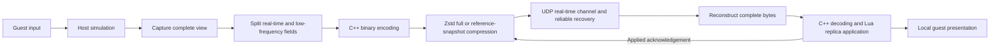

# Network and State Synchronization

The host runs authoritative gameplay. Guests submit input and restore the state published by the host. The network layer handles messages and bytes only; it does not identify items, Bosses, or game objects. State capture and application belong to the bridge synchronization layer.

## Data Flow and Responsibilities

| Data | Direction | Delivery semantics |
| --- | --- | --- |
| Input and requests | Guest → Host | Held values use the latest value; press edges are retained until consumed. The host validates request identity and permissions. |
| Real-time `WorldState` view | Host → Each guest | Every view can be restored as a complete state. Real-time views may be lost; a lost view does not block newer views. |
| Reliable transactions | Bidirectional, primarily published by the host | Lobby, start, restart, checkpoint, floor transition, rewind, end, and return-to-lobby are delivered in order and are not merged into views. |
| Chat communication (`communication`) | Guest request → Host; Host → recipients | Reliable byte messages with an independent limit; not merged into world snapshots. See [Chat and Console](https://github.com/BMingSY/isaac-lan/blob/main/docs/chat-console.md) for the content contract. |

Lifecycle messages (`lifecycle`) use a separate reliable channel with an independent limit. The connection determines the sender; the runtime validates the run identity, generation, and online roster associated with a vote. The `restart` message sent after unanimous consent carries the new run identity, world generation, and startup settings. `ready` validates both run identity and the first tick. See [Party Restart](https://github.com/BMingSY/isaac-lan/blob/main/docs/session-lifecycle.md#party-restart) for voting and exit/rebuild order.

The post-victory `returnLobby` acknowledgement carries the current run identity. A client that has exited enters `returning`, continues polling the connection, and does not start the game. After receiving acknowledgements from all currently online members, the host clears run data, advances the lobby rule generation, and publishes `lobby`. An acknowledgement from an old run or a ready request under old rules cannot release the new lobby barrier. Ending playback does not need to be synchronized frame-for-frame.

Third-party actions use reliable messages with an independent limit; see the [Mod API](https://github.com/BMingSY/isaac-lan/blob/main/docs/third-party-mod-integration.md) for the contract. The host's internal `Frame` aggregates input only; it is not used to make guests replay the same gameplay simulation.

## Input and Time

Guests sample input on local render frames. Repeated polling during the same frame samples only once. `input_hz` supports 30/60 and defaults to 60. Each input contains 16 quantized action values, press edges, and the local mouse target. After a stall, only the current sample is sent; queued historical samples are not replayed.

Single-player input is fixed at 43 bytes: sixteen big-endian `uint16` action values, one `uint16` edge bitmap, one `uint8` mouse-held flag, and two big-endian IEEE 754 `float32` room-target coordinates. The flag must be 0 or 1. Coordinates must be finite and have absolute values no greater than 32768; both axes must be zero when the mouse is not held. The mouse target follows the input sequence and room/floor context. Pause and same-floor transitions preserve the held state; floor changes, disconnect timeout, and session cleanup release it. After chat or a menu captures input, the mouse must be released before shooting can resume. While controlling a character remotely, managed input takes over aiming.

The host consumes input before native simulation steps. A normal in-run update is 30 Hz; the host does not wait for every guest to submit an input sample each frame. Held values may be reused, while edges are cleared after consumption. If no new input arrives for more than 500 ms, neutral input is used. See [Session Lifecycle](https://github.com/BMingSY/isaac-lan/blob/main/docs/session-lifecycle.md#lobby-and-starting-a-run) for the initial loading barrier.

When a guest finishes loading and sends `ready`, the host clears that slot's held input, edges, room context, and acknowledgement sequence. Input sequence numbering restarts at zero after reconnect. Even if the first real-time view arrives before new input, it cannot contain an acknowledgement sequence from the previous connection.

| Identifier | Purpose |
| --- | --- |
| `tick` | Simulation sequence of authoritative state; used for ordering and application acknowledgements |
| `inputSequences` | Input sequences consumed by the host for each player; used to confirm prediction |
| `floorEpoch` | Generation for floor changes, rebuilds, and rewinds; isolates different world states |
| Room key | `(dimension, roomIndex)`; together with the floor generation, limits where input applies |

An acknowledgement confirms that state application completed; it does not compare the two sides' RNG. Menus and local interfaces consume local physical input. Pause and exit use reliable commands. See [Rooms and Presentation](https://github.com/BMingSY/isaac-lan/blob/main/docs/rooms-and-presentation.md#movement-prediction-and-camera) for the display boundary of movement prediction.

## Complete Views and Entity Identity

Each view contains the main state of all party characters, the shared floor and map, and the entities, grids, and presentation data for the recipient's current room. Characters in the same room carry full appearance data; characters in other rooms retain the state needed by the multiplayer HUD. Character `ControlsEnabled` and `ControlsCooldown` are authoritative state. Guests do not advance native character updates, so control-cooldown decrement and reset must be restored with the snapshot. Player fields also carry `Friction` for local movement replay after spider-web and floor slowdowns. Inventory field 12, `subplayer`, is `false` or `{type, hearts}`; it restores only the health of hidden bone/soul forms and does not rebuild their item inventory. Arbitrary private Mod tables, Lua source, and native pointers are not included in views.

Capture uses the immutable generation `(floorEpoch, tick)` and reuses shared fields, characters, and same-room data within that generation. Caches do not cross ticks. Layered projection copies character and room containers, while the encoding cache reuses unchanged child tables. With only one guest, these fragments are not added. Multiple guests share character fields; guests in the same room and dimension also share entity and grid encoding. Sound and animations are filtered by recipient. Fields are defined in [world_schema.lua](https://github.com/BMingSY/isaac-lan/blob/main/src/bridge/sync/world_schema.lua), [fields.lua](https://github.com/BMingSY/isaac-lan/blob/main/src/bridge/sync/fields.lua), and [entity_schema.lua](https://github.com/BMingSY/isaac-lan/blob/main/src/bridge/sync/entity_schema.lua). Common properties for tears, familiars, effects, and sprites are read/written through [named batch capabilities](https://github.com/BMingSY/isaac-lan/blob/main/docs/native-backend.md#batched-entity-field-access). Lua templates determine field order; the version backend preserves original property semantics. Other types use the game's Lua API.

[Layered projection](https://github.com/BMingSY/isaac-lan/blob/main/src/bridge/sync/layers.lua) encodes item lists, trinkets, maps, progress, curses, deals, pills, generated item definitions, room layouts/tracks/sub-room data as low-frequency dependencies. Charge, health, consumables, poop/crafting-bag/temporary effects, positions, entities, grids, animations, and one-time presentation remain in the real-time portion. Capture still runs every tick. "Low frequency" means transmission is change-based, not that authoritative state is read later. UDP dependencies use increasing revision numbers and reliable ordered delivery, and may reference the previous reliable dependency for compression. At most one reliable copy is unacknowledged at a time; changes during that interval are merged into the latest candidate, so intermediate revisions may be skipped. The initial view is reliably delivered. After an application-acknowledgement baseline is established, new unacknowledged revisions are also embedded in real-time views, preventing a lost reliable copy from blocking an entire frame. An embedded copy may arrive before the reliable copy; the receive cache merges by revision number, and the reliable compression dictionary is maintained independently. Each real-time view explicitly references a revision number. A guest restores a complete view only when all corresponding data is available; it cannot apply the newest inventory to an older room or combine data across rooms. Dependency caches, incomplete views, and revision numbers are cleared at generation barriers.

World schema version is 35. The `captured` field is the monotonic millisecond clock when the host begins this capture; offline-generated states without a clock use 0. The capture callback returns real-time bytes and optional dependency bytes. The fifth argument to the application callback receives the matching dependencies. Diagnostic capture of a complete state is still provided by `state.capture`; production transport uses `state.captureTransfer`.

A character's `temporaryEffects` (field 9) is the actual effect set sorted by category and ID. Each entry is `{kind, id, count}`; categories 1/2/3 represent collectibles, trinkets, and Null effects. IDs retain signed 32-bit values; stack count ranges from 1–65535; the set is limited to 4096 entries and duplicate IDs within a category are forbidden. The replica validates the whole group before copying local effect identities, applying count differences, and clearing effects that no longer exist in the authoritative set. Native list references are not retained across add/remove operations. This set is used for native appearance and state queries. It does not call UseActiveItem/UsePill, and guests do not advance effect timers or settle gameplay.

The weapon prefix in character `pose` is read by [weapon_pose.lua](https://github.com/BMingSY/isaac-lan/blob/main/src/bridge/sync/weapon_pose.lua): after a big-endian `BBI4I4f` header are five weapon slots. Each slot begins with a one-byte presence flag. When present, it is followed by `I4ffffI4` (type, cooldown, maximum cooldown, charge, native charge limit, and weapon modifier flags). Costume and layer state after this prefix remain opaque. Attack presentation may construct a local copy that replaces only the charge value; it cannot override cooldown, type, authoritative snapshots, or later payloads. This copy is not included in state encoding or transmission.

Entity field 28, `tether`, is `false` or `{points, sprite, ownerId, ownerPosition, familiarPosition}`. Point payloads contain a big-endian `u16` count followed by three `f32` coordinates per point. Geometry and sprite data come from the authoritative familiar. Guests only draw it and translate endpoints according to the local body and familiar display positions.

NPC field `npc` is a 25-byte record: six big-endian float32 values store X/Y for `V1`, `V2`, and `TargetPosition`, followed by a final byte containing the `IsBoss()` classification (0/1). The first two temporary vectors preserve the floating-point bit patterns of native integer sentinels. Target coordinates must be finite; the receiver validates the entire record before modifying an entity. Guest rendering and native Boss health bars use the synchronized target point and classification, rather than relying on paused NPC AI to complete the state.

Entity IDs are assigned centrally by the host's native identity table and are shared by state capture and damage events. Borrowed addresses, InitSeed, and entity indices are used only to detect whether a native object has been replaced; they are not transmitted. Guests maintain `ID → EntityPtr`. An active object reuses its `EntityPtr` and display-trajectory record. If a native reference becomes invalid or a character object is replaced, the reference is rebuilt. Room changes clear display trajectories; exit clears all references. Restoration first removes expired entities, then creates/updates entities, and finally binds parent, child, spawner, target, and character-carry references. `held` (entity field 27) is the stable ID of a carried object; it is `0` when no object exists or it is not in the current view. Old links are also cleared for characters in other rooms. Identity is independent of local addresses and entity-pool slots; native objects are still allocated and released by the game. Special entity references are integrated through compatibility components and named backend capabilities; see the [Native Capability Reference](https://github.com/BMingSY/isaac-lan/blob/main/docs/native-backend.md#entity-references-and-room-data).

Compatibility display fields for entities are dispatched by `compat/visuals` according to entity type. Components with additional Sprites reuse the entity codec's capture/restore interface and preserve ownership and lifetime of native cached appearance.

When a guest applies a complete view, it follows the [restoration order](https://github.com/BMingSY/isaac-lan/blob/main/docs/layers-and-compatibility.md#capture-and-replica-restoration). The tick is committed only after every step succeeds. If the native floor is not ready, the latest view is retained and application is deferred. Ordinary state may be applied at a native half-frame boundary. The first view, pause/player-list changes, floor changes, room changes, and character replacement are handled at a full-update boundary. `betweenUpdates` preflight does not write to rooms or characters; returning `false` means to keep waiting.

Guests retain native updates needed for presentation and resource cleanup, while gameplay updates and collisions for synchronized entities are intercepted. Damage, pickups, door decisions, and item effects are executed by the host; replica restoration does not replay use actions. Progress writes are temporarily disabled during restoration and guest native updates to prevent inventory rebuilding from triggering achievements again through local collection history. Progress published by the host can still be explicitly applied, and personal progress merging retains its original lifecycle.

## Combat Presentation Events

Top-level `combat` is a bounded event record filtered by recipient and repeated with complete real-time views. The host creates records after the original NPC damage check returns. Each record contains an increasing sequence number, tick, floor generation, room, source and target entity IDs, acceptance result, and original flash duration. The acceptance result includes cancellation by Mod callbacks; it does not mean health has already been deducted. Health, death, and entity lifecycle remain authoritative state. Records are retained for at most 90 ticks and 512 entries. Missing transport data is superseded by later views. A long interruption may lose presentation-only effects without affecting gameplay restoration.

Entity field `combat` (29) describes whether contact prediction is currently allowed: 0 means excluded; 1 means a hittable NPC that can flash; 2 means an ordinary blue/red tear with no special TearFlags that has left the firing wait state. The host reads actual projectile properties and cannot substitute player properties. Replica collision is disabled, so eligibility cannot be inferred from replica collision classes. Prediction is still filtered by local shooter.

Before native restoration, the guest validates event length, count, sequence numbers, enums, and duration. The presentation component filters by floor/room, deduplicates by event sequence, then matches predictions using source/target entity identity. Old state or a different extension fingerprint cannot be used. See [Rooms and Presentation](https://github.com/BMingSY/isaac-lan/blob/main/docs/rooms-and-presentation.md#hit-presentation-prediction) for presentation clocks and cancellation rules.

## Transport, Compression, and Backlog

Connections use IPv4/IPv6 UDP and statically linked ENet 1.3.18 with a [Windows dual-stack adaptation](https://github.com/BMingSY/isaac-lan/blob/main/vendor/enet/README.isaac-lan.md). The host accepts both address families on the same port and falls back to IPv4 listening when the system does not support IPv6. Guests create sockets for the destination address family. DNS A/AAAA records are resolved on a separate thread. Candidate addresses are deduplicated, IPv6 is preferred, and both address families are tried in alternating order. After a connection failure or single-address wait timeout, the next candidate is attempted. Resolution and connection share a total deadline of 10 seconds. Cancellation or reconnect invalidates old resolution results.

The lobby accepts address and port separately. An address may be a hostname, IPv4, or IPv6; IPv6 may be bracketed. A link-local address's `%interface-number` is interpreted using the interface number on the connection initiator. [Endpoint parsing](https://github.com/BMingSY/isaac-lan/blob/main/src/bridge/core/endpoint.lua) uses `[IPv6]:port` to remove colon ambiguity. Address family, 128-bit address, and interface number are used only for local sockets and source validation; they do not change protocol packets. DNS resolution does not provide relay or NAT traversal. The selected address must still be reachable and the corresponding UDP port must be allowed.

Each session's [network thread](https://github.com/BMingSY/isaac-lan/blob/main/src/net/udp_io.cpp) uses socket and wake-up events to handle connections, sending/receiving, message framing, fragment assembly, and real-time view compression/decompression. Main-thread `Session::poll` consumes handed-off results and advances protocol state. After receiving input, the host still advances the game in the current update rather than round-tripping through a background task. Chat and heartbeat byte I/O do not wait for the next frame, while chat business dispatch and UI updates remain on the main thread.

The main and network threads exchange independently owned messages through bounded single-producer/single-consumer queues. The latest view uses a single-value mailbox that replaces older unprocessed values. The network worker does not call Lua, game APIs, log callbacks, or diagnostic callbacks. Diagnostic samples are handed off through a bounded queue and recorded by the main thread. Saves and rewinds use a separate [bulk-data worker](https://github.com/BMingSY/isaac-lan/blob/main/src/net/byte_worker.cpp) to compress, decompress, and validate integrity in the background, avoiding blocking the network thread. Native save capture, Continue, and replica application must run on the main thread. After cancellation, a started task only completes its independent byte result. An old session waits for thread retirement during shutdown; this does not block startup of the next reconnect.

The game protocol version is 46. The ENet connection marker is fixed to `ILAN`; the game protocol number is not used to reject a connection before the handshake. Both sides first exchange a separate, uncompressed, reliable [compatibility message](https://github.com/BMingSY/isaac-lan/blob/main/src/net/compatibility.h). Its envelope, revision, and field order are independent of the game protocol. It carries the Isaac LAN version, extension fingerprint, and game protocol number. All three must match exactly. The version is compiled from [VERSION](https://github.com/BMingSY/isaac-lan/blob/main/VERSION); the extension fingerprint includes the target game-version identity and DLL contents. Before preflight succeeds, the client does not decompress or parse game messages, accept a lobby slot, or start reconnect recovery. Initial joins and reconnects use the same check.

UDP game messages use message envelopes and connection generations and are handed off as complete packets; no byte-stream length prefix is used. [Unified message framing](https://github.com/BMingSY/isaac-lan/blob/main/src/net/wire_codec.h) attempts compression for control, chat, and extension messages of at least 256 bytes. The `0x80 + compressed envelope` is used only when the complete envelope is still smaller. Small messages and messages that do not compress retain their original body. Real-time views, checkpoints, and rewind payloads are compressed as a whole before fragmentation, rather than compressing each fragment separately.

The [Zstd adapter](https://github.com/BMingSY/isaac-lan/blob/main/src/core/zstd.cpp) uses fast level `-1`. For real-time views, an independent frame is compared with a prefix frame referencing a confirmed immutable snapshot, and the smaller payload is selected. Checkpoints and rewinds use independent frames. Raw bytes are used when compression provides no benefit. Prefix compression references the complete snapshot directly; it does not train a dictionary or construct a separate byte patch. Compression contexts are owned and reused by their worker thread, and borrowed prefixes are cleared after each call. Different guests do not share baselines. The first fragment of a real-time view identifies full/reference mode, baseline tick, and floor generation.

The compression envelope contains a one-byte mode and four-byte big-endian original length: `0` for raw bytes, `3` for an independent Zstd frame, and `4` for a prefix frame. `1`/`2` are reserved for reading legacy XPRESS/DEFLATE. A Zstd frame must contain a known original length and content checksum. Trained dictionary IDs, concatenated frames, and trailing bytes are rejected. Output size and window limits are checked before decoding per channel: 4096 bytes for messages, 2 MiB for real-time views, and 8 MiB for saves and rewinds. Zstd is statically linked and does not depend on a system installation or extra DLL.

This delta layer runs after complete-state encoding. The guest must reconstruct the complete bytes before decoding. It reduces transmission size; it does not remove the cost of capturing, encoding, or decoding the complete state. The network layer does not interpret or modify game fields.

UDP uses four channels: reliable control, dependencies, and one-time button presses; unreliable held input; unreliable real-time views; and reliable full-view recovery. ENet handles connection management, checksums, and reliable retransmission. MTU is 1200 bytes. Real-time views that fit in one packet are sent unreliably as-is. Larger views use [independent fragmentation](https://github.com/BMingSY/isaac-lan/blob/main/src/net/world_shards.h) when the fragment count is no more than 1024. The per-packet budget subtracts ENet headers, checksums, and generation envelopes. Each group has up to eight 1024-byte data fragments and two GF(256) parity fragments, allowing recovery of any two missing fragments. Small two- or three-packet deltas use the same path so late fragments of an older view are not discarded just because a newer view arrived. Fragments carry view ID, total length, group number, and fragment number. They are delivered out of order, duplicates are removed, and decompression occurs only after the complete view is reconstructed. If loss exceeds correction capacity, the receiver waits for a newer view. Partial views are bounded by count and bytes; older frames do not have to be completed. The final fragment of a full group adds only one parity fragment. A full group adds approximately 25% payload overhead; smaller groups of two or three fragments have a higher proportion. This does not guarantee delivery during sustained loss or insufficient bandwidth.

The sender rate-limits complete views and disables ENet's random dropping of individual unreliable packets. Each service round hands off at most 16 fragments to avoid filling the receive queue with one large frame. If acknowledgement progress has stalled for more than twice the minimum RTT and at least 200 ms, the interval between new views is at least 100 ms. Reliable recovery queues at most one complete real-time view at a time, with at least 500 ms between sends. Dependencies must still match their revision numbers; an expired recovery result cannot overwrite newer state. Before an application-acknowledgement baseline exists, only this recovery view advances state. Once a baseline exists, real-time views use an independent bounded acknowledgement window and do not wait for old recovery packets to finish reliable retransmission; only one reliable recovery candidate is retained. After the final fragment of a reliable transaction is handed to ENet, a new view waits until the unacknowledged tail is below one fragment. All channels share link capacity and the reliable send window. Capacity for recovery and real-time traffic must be calculated separately; retiring a loss record does not mean ENet has released the recovery packet.

Each guest has an independent latest pending view and confirmed baseline. Every prefix frame directly references that guest's confirmed-applied baseline and does not depend on lost intermediate views. Acknowledgement advances the compression baseline and releases the bounded send window. The window is set using minimum measured RTT, retaining 8–16 state records for loss replacement while also limiting unacknowledged bytes and cache capacity. UDP records unacknowledged for more than 500 ms are treated as lost and released so the latest view can be sent; the sender does not wait indefinitely for acknowledgement of a particular lost packet. The reliable recovery candidate is retained separately. If the baseline is missing, the current delta is discarded; if acknowledgement stalls, a full view is used for recovery. When application acknowledgements continue normally, periodic full frames are not forced. If prefix compression does not save bytes, full encoding is used. Normal packet loss is not treated as protocol corruption.

Application acknowledgements use an unreliable real-time channel and unordered packets, independent of ENet ordering for held input. Only the latest cumulative acknowledgement is retained and repeated every 100 ms. The receiver rejects old acknowledgements by generation and acknowledged-view number. This prevents newer input from evicting a late acknowledgement and prevents acknowledgements from evicting held input. Generation barriers clear old acknowledgements. Unordered fragments for a large view are sent within the same ENet 1024-sequence window; the sender may skip the end of a window when needed. Extremely large payloads that exceed the window use ENet fragmentation and reliable recovery.

UDP held input sends only the latest direction and input sequence. One-time presses are sent through reliable `inputEdges` messages and deduplicated by input sequence. They are consumed after the corresponding or a newer held-input sample arrives. Distinct press events are consumed individually by host updates; retransmission or clustered arrival must not repeat or merge them. Events are bound to room/floor context and expire after more than 120 input samples or when held input has not been updated for more than 500 ms.

The host's reliable generation barrier invalidates old views and button presses. A next-generation state arriving early on the real-time channel is discarded until the control transaction arrives; a subsequent complete view restores state. Room destination and floor progression remain decisions of the session layer.

| Limit | Current value |
| --- | --- |
| Players | Up to 4 |
| Single message body / each large-data fragment | 4096 / 3000 bytes |
| Complete real-time view / checkpoint and save | 2 / 8 MiB |
| Unacknowledged view records | 8–16 per guest, plus one reliable recovery candidate |
| Unacknowledged payload threshold | 64 KiB, with room for one additional current view; UDP loss records are released after 500 ms |
| Complete-view history cache | 16 MiB per connection; guest is additionally limited to 32 views |
| Main/network thread message handoff | 128 messages per direction per connection; stop receiving more when completed receive data reaches 4 MiB, with room for one current view or save |
| Ordinary outgoing byte queue | 256 KiB per connection; UDP reliable messages count until acknowledged/released; large data is sent in transaction batches |
| Reliable large-data/background byte tasks | 4 large-data transactions per connection; 4 pending tasks per worker thread |

When the send window is full, only the pending latest view is updated. The UDP window may also release records on timeout; not every view requires an acknowledgement. Backlog for one guest does not require the host to pause other players. Floor-transition/rewind transactions invalidate old views, assembly state, and baselines. A new connection establishes a baseline from a complete view; acknowledgements from an old generation cannot establish a new baseline.

## State Encoding and Decoding

Lua defines the game-field contract, capture, and restoration order, and accesses properties through game APIs or named batch capabilities. [`state_encode(value, memo)` / `state_decode(bytes)`](https://github.com/BMingSY/isaac-lan/blob/main/src/engine/state_codec.cpp) batch-process arrays on the main thread through the shared Lua 5.3 ABI. Byte I/O and size limits are in the portable [state_codec.h](https://github.com/BMingSY/isaac-lan/blob/main/src/core/state_codec.h). The codec does not access game objects, native layouts, or network connections. The Lua [reference implementation](https://github.com/BMingSY/isaac-lan/blob/main/src/bridge/sync/codec.lua) is used for offline comparison and fixtures without native bindings.

Values are limited to booleans, integers, finite float32 values, strings, and ordinary arrays. Type tags, integer widths, and big-endian encoding are checked byte-for-byte against the native and Lua reference implementations. Integer and floating-point types, negative zero, and signed 64-bit values are preserved. Encoding uses a contiguous buffer. If Lua allocation fails, the userdata finalizer releases the C++ buffer; on normal return or C++ validation failure, it is released immediately.

The `memo` is owned by the capture component and marks only arrays immutable within the current capture generation. Cache entries record complete bytes, node count, and relative depth. Repeated references still count toward the budget for the entire view. Ordinary arrays are not cached automatically. Do not modify content or cache metadata after marking an array.

When a guest applies a complete view, the latest decoded result is retained only if preflight has not yet entered native restoration and the same state must be deferred from a half-frame to a full update. Byte or tick changes, floor waiting, view reset, or beginning restoration invalidate this cache. Inventory comparison checks character type, collectible type/count, and trinket slots directly. Native inventory correction still runs every 30 ticks.

For tears, familiars, pickups, and effect entities, `nativeFields` (entity field 26) carries a numeric block in this order: generic property array, type-specific property array, sprite offset, sprite scale, and color. Original positions 8, 9, 15, 16, and 17 are `false`. The numeric block uses the same tags and big-endian encoding. A named field plan captures/restores it directly on the native side, avoiding per-frame construction and traversal of intermediate Lua tables. Other entities and the offline Lua reference path continue to use expanded property arrays; entity field 26 is `false`. Entity field 18 carries frame age only for tears, allowing the guest to identify the same shot during prediction; other entities keep `false`, and the world clock is still restored from the top-level frame number. Sprite field 11 is also `false`; complete color, including colorize, is carried and applied exactly once in the native Sprite block. Field names and order are defined in [entity_schema.lua](https://github.com/BMingSY/isaac-lan/blob/main/src/bridge/sync/entity_schema.lua), [entity_codec.lua](https://github.com/BMingSY/isaac-lan/blob/main/src/bridge/sync/entity_codec.lua), and [fields.lua](https://github.com/BMingSY/isaac-lan/blob/main/src/bridge/sync/fields.lua). The native whitelist does not determine gameplay or reference relationships.

## Validation and Failure Boundaries

| Boundary | Checks and result |
| --- | --- |
| Handshake | Full Isaac LAN version, extension fingerprint, and protocol number must match. Third-party Mod fingerprint differences are warnings only. |
| Messages and fragments | Validate field ranges, sequence numbers, offsets, and integrity. UDP discards duplicate, expired, or wrong-generation real-time state; malformed messages are still rejected. |
| State encoding | Accept only booleans, integers, finite float32 values, strings, and arrays; fewer than 250,000 nodes; depth below 12; string and array lengths up to 65,535. |
| Replica application | Validate floor readiness, character/controller ownership, and entity fields. On failure, do not commit the completed tick; native writes already performed are not automatically rolled back. |

Protocol and field versions are managed separately by [protocol.h](https://github.com/BMingSY/isaac-lan/blob/main/src/net/protocol.h) and [world_schema.lua](https://github.com/BMingSY/isaac-lan/blob/main/src/bridge/sync/world_schema.lua). When changing fields, update producers, consumers, version/fingerprint, and related contracts together.

A compatibility failure rejects only the corresponding connection. The host records the reason and both versions on the main thread; other players and original reconnect slots are unaffected. Guest state `compatibilityError` retains `reason` (`version`, `fingerprint`, `protocol`, or `unavailable`), `localVersion`, and `remoteVersion`. The menu displays the failure reason and both versions; the next connection clears the old error. Different DLLs with the same version show a build mismatch. If the peer does not provide a valid compatibility message, its version is empty and shown as "Unknown"; this does not prove a specific version mismatch. Older versions that do not support this message cannot join; their own interface continues to use the original error notice.

World field version is 36. Native sprite payload format is 2 and includes animation attachment frames and event state. Character field 10 stores the identity returned by `GetBabySkin()`; it is restored with the character before inventory. Characters and costumes still restore authoritative poses at the render boundary. Matching animation names are restored from the complete state to avoid reinitializing animation every frame. Different field versions cannot be applied to one another. Embedded modules and DLL fingerprints continue to participate in connection validation.

World field `challenge` is `false` or `[rule ID, rule version, component payload]`. The challenge component validates and restores its own dynamic progress; see [Multiplayer Challenges](https://github.com/BMingSY/isaac-lan/blob/main/docs/lan-challenges.md) for the contract. When a per-player map strategy is enabled, map display and exploration fields are projected by recipient. Layout, room clearing, and drops are still captured from the same authoritative floor. UDP message layout is checked through the protocol version; world fields and embedded modules are checked through their own versions and the extension fingerprint.

A guest protocol or application error ends its current game and returns to the lobby. An error in the host's own bridge may end the entire session; see [Failure Boundaries](https://github.com/BMingSY/isaac-lan/blob/main/docs/session-lifecycle.md#failure-boundaries). Ping is round-trip time including host response processing and transport queueing; it is not a substitute for state-processing duration. See the [Diagnostics Reference](https://github.com/BMingSY/isaac-lan/blob/main/docs/diagnostics-and-resource-testing.md) for measurement and troubleshooting.
